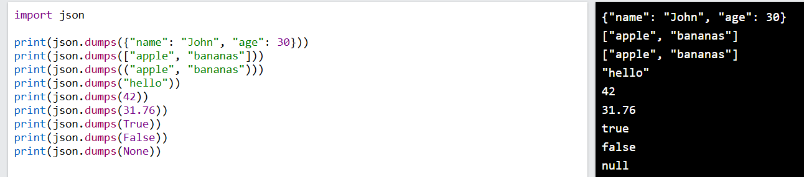

## What is JSON?

JSON (JavaScript Object Notation) is a lightweight, text-based format used to store and exchange data between systems — most commonly between a client and a server, or between different programs.

Python has a built-in `json` module to work with it:

- `json.dumps()` → converts a Python object into a JSON string
- `json.dump()` → writes a Python object into a JSON file
- `json.loads()` → converts a JSON string back into a Python object
- `json.load()` → reads a JSON file back into a Python object

### Screenshot Breakdown (Line by Line)

- `json.dumps({"name": "John", "age": 30})` → Converts a Python `dict` into a JSON Object `{"name": "John", "age": 30}`.
- `json.dumps(["apple", "bananas"])` → Converts a Python `list` into a JSON Array `["apple", "bananas"]`.
- `json.dumps(("apple", "bananas"))` → Converts a Python `tuple` into a JSON Array `["apple", "bananas"]`.
- `json.dumps("hello")` → Converts a Python `str` into a JSON String `"hello"`.
- `json.dumps(42)` → Converts a Python `int` into a JSON Number `42`.
- `json.dumps(31.76)` → Converts a Python `float` into a JSON Number `31.76`.
- `json.dumps(True)` / `json.dumps(False)` → Converts Python Booleans to lowercase JSON booleans `true` / `false`.
- `json.dumps(None)` → Converts Python `None` into JSON `null`.

### Python to JSON Type Mapping

| Python | JSON |
|---|---|
| dict | object |
| list, tuple | array |
| str | string |
| int, float | number |
| True / False | true / false |
| None | null |

---

## Questions

1. What is JSON, and why is it commonly used?
2. What Python module is used to work with JSON?
3. What does `json.dumps()` do?
4. What is the difference between `json.dump()` and `json.dumps()`?
5. What is the difference between `json.load()` and `json.loads()`?
6. How do you convert a JSON string back into a Python object?
7. Which Python data types can `json.dumps()` handle natively?
8. What happens to a Python tuple when converted using `json.dumps()`?
9. What does Python's `None` become in JSON?
10. What do `True` and `False` become in JSON output?
11. How do you pretty-print JSON output with indentation?
12. How do you sort dictionary keys alphabetically in JSON output?
13. How can you change the separators used in JSON output?
14. How do you preserve non-ASCII (Unicode) characters in JSON output?
15. What error is raised if you try to serialize an object `json.dumps()` doesn't support (like a `datetime` object)?
16. How can you serialize a `datetime` object using `json.dumps()`?
17. How would you serialize a custom class instance to JSON?
18. How do you deserialize JSON into a custom Python object instead of a plain dict?
19. What error occurs when JSON data is malformed, and what attributes help you debug it?
20. What happens if a Python dictionary has non-string keys (like integers) when passed to `json.dumps()`?